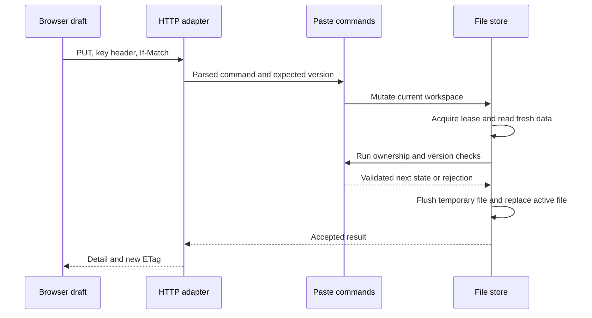

# Trace lab: where is a change accepted?

Work through each trace with the source open. Write down the browser draft, headers, current record version, workspace revision and persisted bytes before predicting the response. Then compare your prediction with a test or a disposable browser session.

**Trace A: ordinary creation.** Begin with workspace revision 0. The browser generates request R and key K for body B. The server finds no receipt, creates paste P at version 1, adds the receipt and activity, and replaces the workspace at revision 1. The response contains P's slug and version. The browser displays a receipt containing K. Explain why the stored hash is enough to verify later possession but cannot recover the original key for the user.

**Trace B: lost creation response.** Repeat Trace A but pretend the response never arrives. The browser retains R, K and B. On retry the server finds the receipt and the matching fingerprint. It returns P without changing revision 1. If the user edits B but reuses R, the server rejects it. If P was deleted, the receipt still prevents recreation. Identify the precise branch that handles each case in `CreateAsync`.

**Trace C: conflicting edits.** Both tabs open P at version 1. Tab A saves and receives version 2. Tab B submits version 1. The store reads the current version under its lease and rejects the stale command. No new activity entry or replacement should occur. The textarea remains a draft. Checking current data updates the saved representation but does not change the draft's expected version.

**Trace D: failed replacement.** Hold the active file open in a way that denies replacement, as the Windows backend check does. A new temporary file may be written and flushed, but the final move fails. The accepted file should retain its previous bytes, and the request must not return a successful creation receipt. Distinguish this observed failure from a connection loss after a successful replacement: the latter leaves the client uncertain even though the server accepted the change.

**Trace E: migration.** The command reads the original legacy bytes, validates the known array shape, constructs a candidate workspace, writes an exact recovery copy and creates a previously absent active workspace. It refuses to replace an existing workspace. Historical view counts and older key hashes remain attached to migrated records. Explain why invalid fields are reported for review rather than silently trimmed, guessed or replaced with sample data.

Finish with a short explanation for a teammate: which request can be retried identically, which request needs a current-version review, and which storage problem requires preserving a file for operator inspection? If those answers are different, you understand the boundaries better than a generic “try again” message would suggest.
